# Drones Ukraine v2 : trajectoires réalistes, classification et cartographie

Version 2 du projet de classification de drones dans la guerre russo-ukrainienne. Elle **complète** la v1 sans la modifier : les notebooks R, les CSV et la présentation à la racine du dépôt sont inchangés. Tout le travail v2 se trouve dans ce dossier.

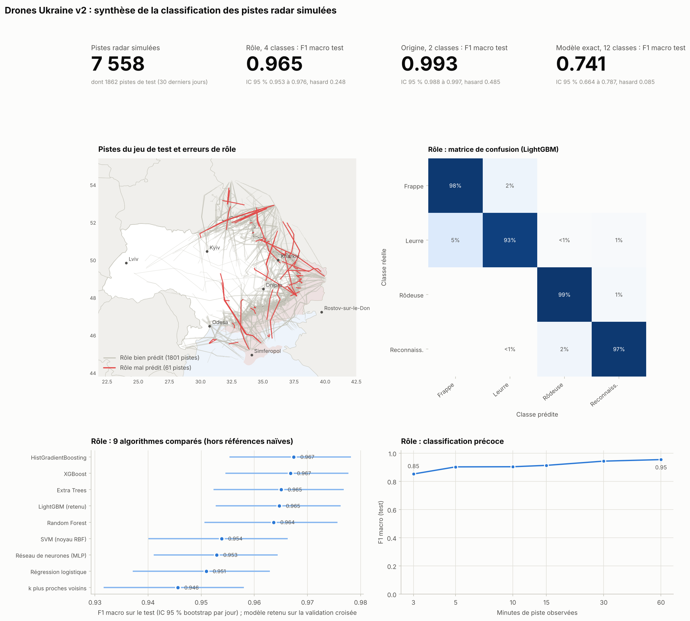

## Ce qu'apporte la v2

* **Trajectoires cohérentes** : 12 modèles réellement employés (Shahed-136, Gerbera, Lancet-3, Orlan-10, Supercam S350, An-196 Liutyi, UJ-26 Bober, UJ-22 Airborne, Warmate, Leleka-100, A1-SM Furia, Valkyria), paramétrés par des sources ouvertes citées, avec des profils de mission propres à chaque rôle, des raids mêlant drones d'attaque et leurres, le vent, la défense adverse et un modèle radar (portée, bruit, pistes fragmentées).
* **Apprentissage automatique rigoureux** : neuf algorithmes (régression logistique, k plus proches voisins, SVM, Random Forest, Extra Trees, HistGradientBoosting, XGBoost, LightGBM, réseau de neurones) comparés selon un protocole sans fuite de données, avec références naïves, intervalles de confiance, test de permutation, diagnostics de sur-apprentissage et tests de robustesse.
* **PCA et clustering** : structure des comportements de vol découverte sans étiquette (K-Means, mélange gaussien, CAH de Ward, HDBSCAN).
* **Visualisations** : figures statiques et cartes interactives (Leaflet), dont l'animation d'un raid nocturne vu par le radar.

## Organisation

| Élément | Contenu |
|---|---|
| `1_generation_trajectoires_v2.ipynb` | catalogue OSINT, théâtre, simulation, contrôles de cohérence, observation radar, variables |
| `2_classification_ML_v2.ipynb` | protocole anti-fuite, comparaison des algorithmes, diagnostics, robustesse, comparaison avec la v1 |
| `3_PCA_clustering_v2.ipynb` | PCA, choix du nombre de groupes, partitions, stabilité, t-SNE, groupes sur la carte |
| `4_visualisations_geospatiales_v2.ipynb` | cartes interactives et planche de synthèse |
| `drone_v2/` | code Python : `geo`, `catalogue`, `simulation`, `radar`, `variables`, `ml`, `experiences`, `non_supervise`, `viz`, `cartes` |
| `data/referentiels/` | catalogue des drones, sites de lancement, cibles, zones de lancement (CSV sourcés) |
| `data/geo/` | frontières Natural Earth 1:50m |
| `data/generees/` | vols, pistes radar, variables, échantillon cartographique, radars fictifs |
| `figures/`, `cartes/`, `rapports/` | figures PNG, cartes HTML, résultats chiffrés (CSV, JSON) |
| `tests/` | tests automatiques (cohérence physique, reproductibilité, garde-fous anti-fuite) |

## Lancer la v2

```bash
cd v2
pip install -r requirements.txt
python run_v2.py              # exécute les 4 notebooks dans l'ordre (environ une heure sur 4 cœurs)
python run_v2.py --rapide     # version courte du notebook 2
python -m pytest -q tests     # tests automatiques
```

Les notebooks peuvent aussi être ouverts et exécutés un par un. La simulation est déterministe (graine 2026) : les plots radar complets et la vérité terrain, trop volumineux pour le dépôt, sont régénérés à l'identique si besoin.

## 1. Génération de trajectoires

**Catalogue.** Valeurs publiées (vitesse de croisière, portée) et hypothèses de simulation clairement séparées (préfixe `hyp_`) :

| Modèle | Origine | Rôle | Croisière (km/h) | Portée (km) | Sources |
|---|---|---|---|---|---|
| Shahed-136 (Geran-2) | Russie | Frappe longue portée | 150 à 185 | 2000 | WIKI_SHAHED, GS_GERAN2, GUR_GERAN2, BI_SHAHED_ALT, EMP_SHAHED_2025 |
| Gerbera | Russie | Leurre | 90 à 130 | 600 | WIKI_GERBERA, GUR_GERBERA, CAPSS_GERBERA, ISIS_LEURRES |
| Lancet-3 | Russie | Munition rôdeuse | 80 à 110 | 40 | WIKI_LANCET, GS_LANCET |
| Orlan-10 | Russie | Reconnaissance | 90 à 120 | 120 | GS_ORLAN10, WIKI_ORLAN10 |
| Supercam S350 | Russie | Reconnaissance | 75 à 120 | 100 | GUR_S350 |
| An-196 Liutyi | Ukraine | Frappe longue portée | 150 à 200 | 2000 | WIKI_LIUTYI |
| UJ-26 Bober (Babor v1) | Ukraine | Frappe longue portée | 120 à 200 | 1000 | WIKI_BOBER, NV_BOBER |
| UJ-22 Airborne | Ukraine | Frappe longue portée | 120 à 140 | 800 | GS_UJ22 |
| Warmate | Ukraine | Munition rôdeuse | 80 à 120 | 30 | WIKI_WARMATE |
| Leleka-100 | Ukraine | Reconnaissance | 65 à 80 | 45 | AT_LELEKA, USS_LELEKA |
| A1-SM Furia | Ukraine | Reconnaissance | 65 à 85 | 50 | GS_FURIA, MSPO_FURIA |
| Valkyria | Ukraine | Reconnaissance | 55 à 75 | 35 | MVS_VALKYRIA, UP_VALKYRIA |

URL complètes : `data/referentiels/catalogue_drones_v2.csv` et section Sources ci-dessous.

**Simulation** (7302 vols sur 120 jours fictifs, 7558 pistes radar) :

* frappe longue portée : raids nocturnes par groupes, routes programmées avec détours, couloirs (frontière biélorusse, mer Noire) et feintes, vol bas ou haut (tendance 2025), piqué terminal ;
* leurres Gerbera : 30 à 55 % des drones d'un raid russe, vol jusqu'à épuisement du carburant ;
* munitions rôdeuses : orbites de recherche au-delà de la ligne de contact puis piqué ;
* reconnaissance : hippodromes, orbites, balayages ou points d'intérêt dans le rayon d'action publié, retour et atterrissage ;
* vent quotidien, défense adverse (drones abattus ou brouillés), réseau radar fictif avec horizon radioélectrique, surface équivalente radar, bruit de mesure et pistes fragmentées.

Garde-fou contre les valeurs inventées : le notebook 1 vérifie que vitesses de croisière, rayons d'action et endurances simulés restent dans les valeurs publiées.

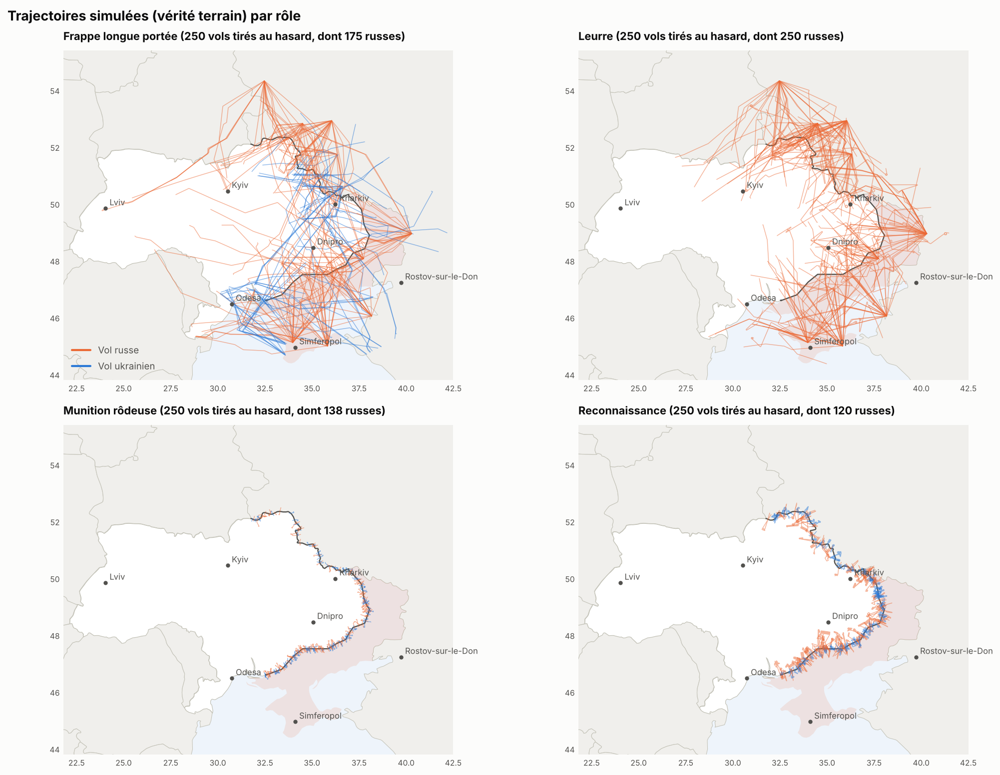

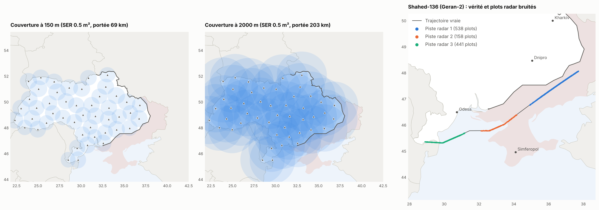

## 2. Classification supervisée

**Protocole** : unité = piste radar ; variables calculées uniquement sur les plots observés ; jeu de test = 30 derniers jours, jamais utilisé pour les choix ; validation croisée groupée par jour (les drones d'un même raid restent ensemble) ; prétraitements dans des pipelines ; modèle retenu sur la validation croisée ; intervalles de confiance par bootstrap des jours de test.

**Résultats sur le jeu de test** (1862 pistes jamais vues) :

| Cible | Modèle retenu | F1 macro validation croisée | F1 macro test (IC 95 %) | Exactitude test | Tirage au hasard |
|---|---|---|---|---|---|
| Rôle (4 classes) | LightGBM | 0,963 ± 0,011 | **0,965** (0,953 à 0,976) | 0,967 | 0,248 |
| Origine (2 classes) | Extra Trees | 0,991 ± 0,002 | **0,993** (0,988 à 0,997) | 0,994 | 0,485 |
| Modèle exact (12 classes) | XGBoost | 0,775 ± 0,018 | **0,741** (0,664 à 0,787) | 0,854 | 0,085 |

**Algorithmes comparés (rôle)** :

| Algorithme | F1 validation croisée | F1 test |
|---|---|---|
| HistGradientBoosting | 0,961 | 0,967 |
| XGBoost | 0,961 | 0,967 |
| Extra Trees | 0,957 | 0,965 |
| LightGBM | 0,963 | 0,965 |
| Random Forest | 0,956 | 0,964 |
| SVM (noyau RBF) | 0,951 | 0,954 |
| Réseau de neurones (MLP) | 0,947 | 0,953 |
| Régression logistique | 0,940 | 0,951 |
| k plus proches voisins | 0,948 | 0,946 |

**Contrôles anti-sur-apprentissage et anti-hasard (rôle)** :

* comparaison appariée sur les mêmes pistes de test (bootstrap des jours) : LightGBM contre Random Forest : écart 0,001 (IC 95 % -0,004 à 0,006, non significatif) ; LightGBM contre XGBoost : écart -0,002 (IC 95 % -0,006 à 0,002, non significatif) ; LightGBM contre Régression logistique : écart 0,014 (IC 95 % 0,005 à 0,024, significatif) ;
* test de permutation des étiquettes : F1 0,963 avec les vraies étiquettes contre 0,252 en moyenne (maximum 0,270) sur 99 permutations, p = 0,010 ;
* calibration : erreur de calibration attendue 0,016, score de Brier 0,050 ;
* découpage naïf (aléatoire) contre découpage groupé par jour, F1 de validation croisée d'une Random Forest : rôle 0,957 contre 0,955, modèle exact 0,802 contre 0,769 ;
* ablation : avec la seule physique du vol (cinématique et altitude), F1 test 0,957 pour le rôle et 0,899 pour l'origine ; toutes variables : 0,965 et 0,993.

**Classification précoce** (F1 macro test selon la durée de piste observée) :

| Observation | Rôle | Origine | Modèle |
|---|---|---|---|
| 3 min | 0,85 | 0,99 | 0,56 |
| 5 min | 0,90 | 0,99 | 0,58 |
| 10 min | 0,90 | 0,99 | 0,62 |
| 15 min | 0,91 | 0,99 | 0,61 |
| 30 min | 0,94 | 0,99 | 0,68 |
| 60 min | 0,95 | 0,99 | 0,72 |

**Radar dégradé** (modèles entraînés au bruit nominal) :

| Bruit radar | Rôle | Origine | Modèle |
|---|---|---|---|
| ×1,0 | 0,96 | 0,99 | 0,74 |
| ×1,5 | 0,95 | 0,99 | 0,71 |
| ×2,0 | 0,93 | 0,99 | 0,63 |
| ×3,0 | 0,90 | 0,98 | 0,55 |
| ×4,0 | 0,89 | 0,94 | 0,50 |

**Secteur géographique jamais vu** (rôle, variables physiques seulement) :

| Secteur de test | Pistes | Secteur vu à l'apprentissage | Secteur jamais vu |
|---|---|---|---|
| Nord | 656 | 0,958 | 0,954 |
| Est | 587 | 0,959 | 0,950 |
| Sud | 619 | 0,965 | 0,965 |

**Comparaison avec la v1.** Les cinq variables de la v1, recalculées sur les pistes radar de la v2 avec la forêt aléatoire de la v1, donnent un F1 test de 0,657 (rôle), 0,796 (origine) et 0,347 (modèle), contre 0,965, 0,993 et 0,741 avec les variables et le protocole v2. Dans la v1, l'altitude était tirée selon le type de drone (bandes disjointes entre drones suicide et de reconnaissance) et tous les drones russes entraient dans la zone par sa bordure : les deux tâches étaient séparables par construction, d'où les 100 % d'exactitude.

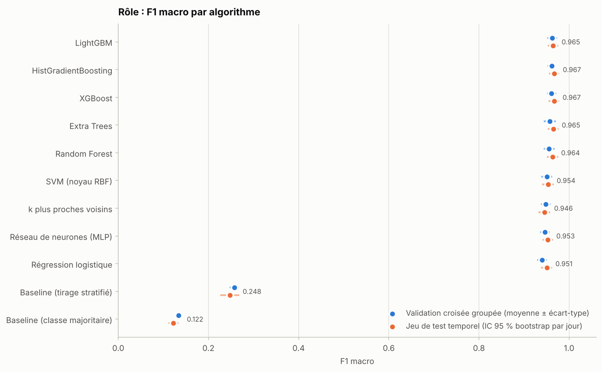

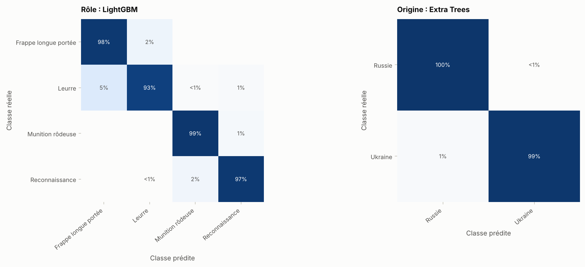

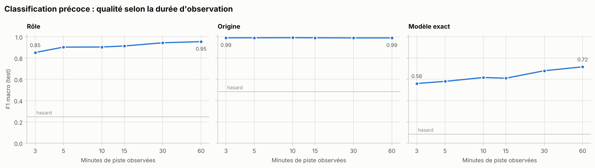

## 3. PCA et clustering

* PCA sur les variables physiques (géographie et heure exclues) : 8 composantes expliquent 92,0 % de la variance.
* K-Means (k = 3, choisi par la silhouette) : ARI avec les rôles 0,409, stabilité (ARI moyen sur 25 sous-échantillons) 0,997.
* HDBSCAN : 3 groupes denses, 39,5 % des pistes classées en bruit, ARI avec les rôles 0,681 et homogénéité 0,676 sur les pistes regroupées.
* Les leurres, conçus pour imiter les Shahed, ne forment pas de groupe distinct sans supervision : la séparation leurre/frappe demande un modèle supervisé.

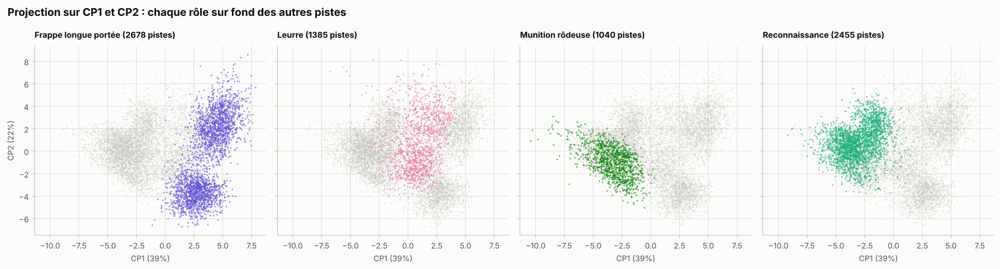

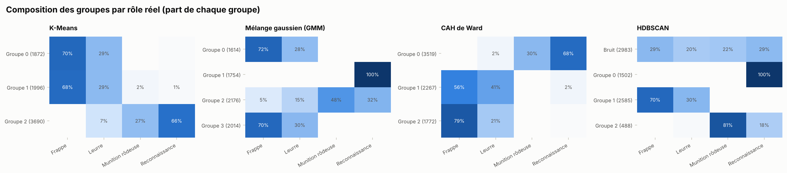

## 4. Cartes interactives

À ouvrir dans un navigateur (connexion internet nécessaire pour le fond de carte et les bibliothèques JavaScript) :

| Carte | Contenu |
|---|---|
| `cartes/carte_trajectoires_v2.html` | échantillon de pistes radar par rôle et origine, sites de lancement, zones fictives, radars |
| `cartes/carte_predictions_test_v2.html` | pistes du jeu de test colorées par rôle prédit, erreurs en rouge, détail au clic |
| `cartes/animation_raid_v2.html` | raid nocturne rejoué minute par minute |
| `cartes/carte_densite_v2.html` | densité des détections par origine |
| `cartes/carte_groupes_v2.html` | groupes K-Means sur la carte |
| `cartes/pca_3d_v2.html` | projection PCA 3D interactive |

Aperçus (captures hors ligne, sans le fond de carte en tuiles qui s'affiche dans un navigateur connecté) :

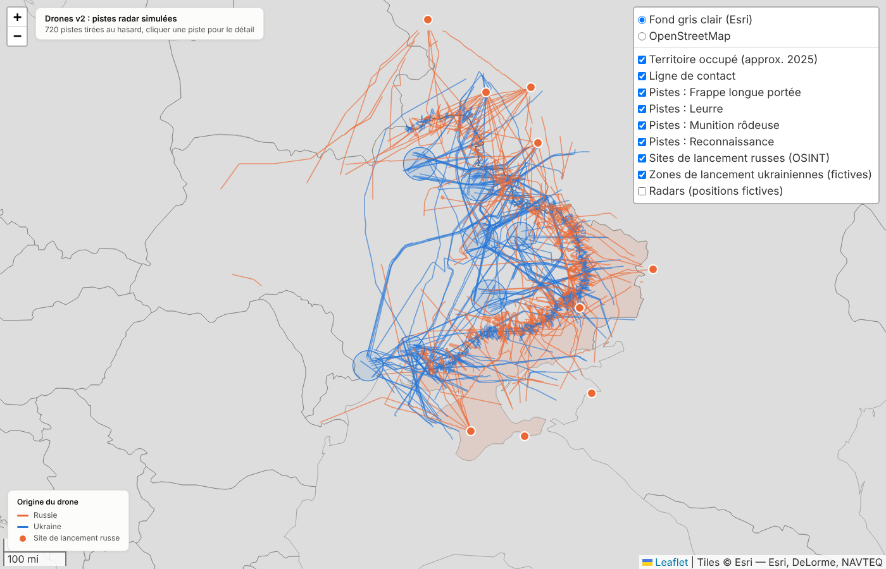

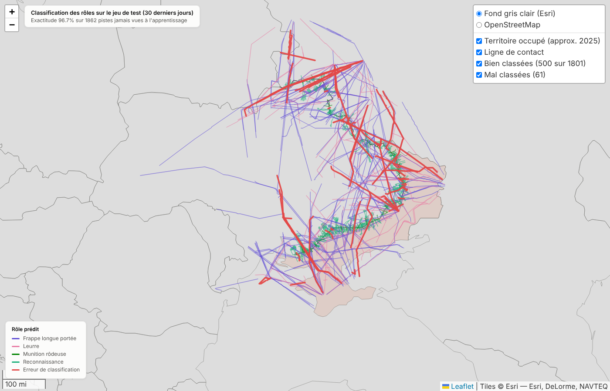

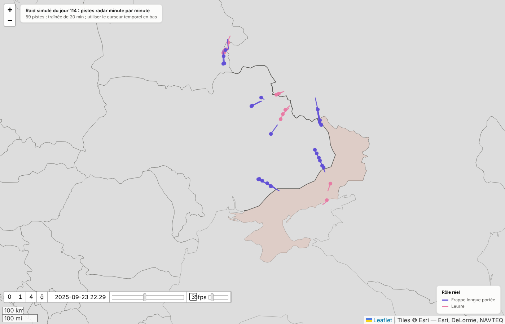

## Limites

* **Données synthétiques.** Les scores mesurent la capacité des méthodes à retrouver les régularités du simulateur. Ils ne constituent pas une performance opérationnelle : de vraies pistes radar contiendraient d'autres sources de confusion (aéronefs civils, oiseaux, fouillis, fusion multi-capteurs, tactiques changeantes).
* **Sources ouvertes imparfaites.** Les caractéristiques publiées divergent d'une source à l'autre et certaines manquent (vitesse du Liutyi, altitudes d'emploi) ; elles sont alors remplacées par des hypothèses explicites.
* **Géographie simplifiée.** Ligne de front approximative (2025), radars et zones de lancement ukrainiennes fictifs.
* **Contexte favorable à l'origine.** Le sens de traversée de la ligne de contact rend l'origine facile à prédire ; l'ablation montre ce que vaut la seule physique du vol.

## Sources

* `WIKI_SHAHED` : https://en.wikipedia.org/wiki/HESA_Shahed_136
* `GS_GERAN2` : https://www.globalsecurity.org/military/world/russia/geran-2.html
* `GUR_GERAN2` : https://war-sanctions.gur.gov.ua/en/uav/336
* `BI_SHAHED_ALT` : https://www.yahoo.com/news/russia-drone-tactic-dive-bombing-060045080.html
* `EMP_SHAHED_2025` : https://euromaidanpress.com/2025/06/29/why-cant-ukraine-stop-russias-shahed-drones-anymore/
* `WIKI_GERBERA` : https://en.wikipedia.org/wiki/Gerbera_(drone)
* `GUR_GERBERA` : https://war-sanctions.gur.gov.ua/en/uav/329
* `CAPSS_GERBERA` : https://capssindia.org/?p=16521
* `ISIS_LEURRES` : https://isis-online.org/isis-reports/a-comprehensive-analytical-review-of-russian-shahed-type-uavs-deployment-against-ukraine-in-2025
* `WIKI_LANCET` : https://en.wikipedia.org/wiki/ZALA_Lancet
* `GS_LANCET` : https://www.globalsecurity.org/military/world/russia/lancet-specs.htm
* `GS_ORLAN10` : https://www.globalsecurity.org/military/world/russia/orlan-10-specs.htm
* `WIKI_ORLAN10` : https://en.wikipedia.org/wiki/Orlan-10
* `GUR_S350` : https://war-sanctions.gur.gov.ua/en/uav/217
* `WIKI_LIUTYI` : https://en.wikipedia.org/wiki/Liutyi
* `WIKI_BOBER` : https://en.wikipedia.org/wiki/Bober_(drone)
* `NV_BOBER` : https://english.nv.ua/nation/uj-26-bober-the-drone-hitting-deep-inside-russia-50619436.html
* `GS_UJ22` : https://www.globalsecurity.org/military/world/ukraine/uj-22-specs.htm
* `WIKI_WARMATE` : https://en.wikipedia.org/wiki/WB_Electronics_Warmate
* `AT_LELEKA` : https://www.army-technology.com/projects/leleka-100-unmanned-aerial-vehicle-uav-ukraine/
* `USS_LELEKA` : https://ukrspecsystems.com/drones/leleka-100-electric-uav
* `GS_FURIA` : https://www.globalsecurity.org/military/world/ukraine/furia-uav.htm
* `MSPO_FURIA` : https://www.targikielce.pl/en/mspo/list-of-exhibitors/athlon-avia,3818965
* `MVS_VALKYRIA` : https://mvs.gov.ua/en/news/u-tilu-voroga-prikordonniki-vikonuiut-zavdannia-zavdiaki-bezpilotnomu-kompleksu-valkiriia-video
* `UP_VALKYRIA` : https://www.pravda.com.ua/eng/news/2026/02/04/8019364
* Natural Earth (frontières, domaine public) : https://www.naturalearthdata.com
* Sites de lancement : voir `data/referentiels/sites_lancement_russes_v2.csv`
